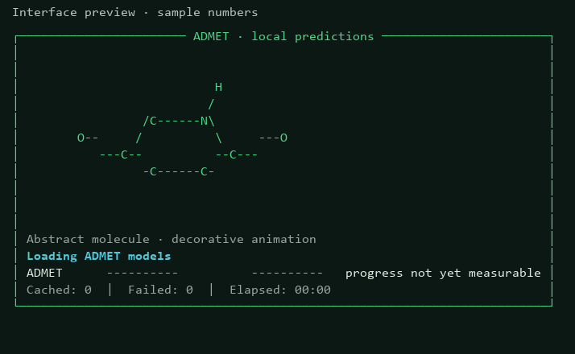

# DockScreen 0.3.0


[English guide](README.md)

DockScreen помогает подготовить небольшие молекулы, провести докинг с подготовленными белками и изучить полученных кандидатов. Для начала достаточно нумерованного меню. Ниже есть и команды для повторяемых запусков.

В программе четыре разных шага:

| Шаг | Что делает | Что получится |
|---|---|---|
| Докинг | Размещает молекулу в выбранной области белка и оценивает положения | Позы молекулы и docking score |
| ADMET, по желанию | По SMILES предсказывает свойства всасывания, распределения, метаболизма, выведения и токсичности | Модельные оценки и прогнозируемые свойства |
| Парето, по желанию | Применяет ограничения и убирает кандидата, если другой не хуже по всем целям и лучше хотя бы по одной | Фронт и объяснение решения по каждой строке |
| SMAA, по желанию | Много раз ранжирует допустимых кандидатов с разными весами целей | Доли попадания на каждое место и в топ-N |

Это расчётные инструменты для исследования. Они не устанавливают измеренную активность, селективность, клиническую безопасность или пригодность молекулы как лекарства.

## 1. Установить и открыть

Стабильная версия находится в [GitHub Releases](https://github.com/Kirill-K-ITMO/DockScreen/releases/tag/v0.3.0).
Для Windows проще всего скачать архив с Vina. Git нужен только для необязательного
варианта с клонированием ниже. Python и его зависимости устанавливаются отдельно:
в архивах их нет.

### Windows: скачать готовый релиз

1. Установите **Python 3.12, 64-бит**, вместе с **Python launcher** с [python.org](https://www.python.org/downloads/windows/). В PowerShell проверьте: команда `py -3.12 --version` должна вывести Python 3.12.
2. На странице релиза раскройте **Assets** и скачайте **`DockScreen_0.3.0-Windows-with-Vina.zip`**. В нём есть проверенный исполняемый файл Vina. Архив `DockScreen_0.3.0-source.zip` и стандартные архивы GitHub **Source code** содержат исходники; Vina для них нужно установить отдельно.
3. Распакуйте архив в доступную для записи папку. Откройте внутри папку **`DockScreen`**, где находятся `INSTALL.cmd` и `main.py`. Не запускайте программу прямо из ZIP.
4. Запустите **INSTALL.cmd** и дождитесь завершения. Для скачивания зависимостей нужен интернет. Установщик создаст `.venv` для докинга и анализа. Ответьте `y` или `да`, чтобы добавить ADMET в отдельное окружение `.venv-admet`, либо нажмите Enter, чтобы оставить только докинг.
5. Запустите **CHECK.cmd**. После успешной проверки откройте **START.cmd**. Введите номер пункта меню и нажмите Enter; для выхода введите `0`.

В релизе также есть **`SHA256SUMS.txt`**. Контрольную сумму скачанного архива можно
сравнить со значением из этого файла. Команда PowerShell:

```powershell
Get-FileHash .\DockScreen_0.3.0-Windows-with-Vina.zip -Algorithm SHA256
```

<details>
<summary>Альтернатива: установка исходников (Git / Windows / Linux)</summary>

Если установлен Git, откройте терминал в папке, где хотите разместить DockScreen:

```bash
git clone --branch v0.3.0 --depth 1 https://github.com/Kirill-K-ITMO/DockScreen.git DockScreen
cd DockScreen
```

Команда выбирает фиксированный релиз **v0.3.0**, а не меняющуюся ветку разработки.
Без Git скачайте **Source code (zip)** на странице релиза, распакуйте архив и
откройте папку с `main.py`. Исходники не содержат Vina и установленных Python-окружений.

**Настройте Vina до проверки готовности.** Скачайте исполняемый файл для своей
операционной системы из [официального релиза AutoDock Vina 1.2.7](https://github.com/forlilab/AutoDock-Vina/releases/tag/v1.2.7).
При необходимости создайте папку `tools/`. Для Windows поместите файл в
`tools/vina.exe` и запишите в `settings/app_settings.json`:

```json
{"vina_executable": "tools/vina.exe"}
```

Для Linux используйте Linux-файл `tools/vina`, разрешите его запуск командой
`chmod +x tools/vina` и укажите `{"vina_executable": "tools/vina"}`. Пути в этой
настройке считаются от **папки проекта**, а не от папки `settings`. Если Vina уже
доступна через PATH, можно указать `"vina"`. При распространении исполняемого файла
сохраняйте относящиеся к нему лицензии и уведомления.

В **Windows** выполните из папки проекта:

```powershell
.\INSTALL.cmd
.\CHECK.cmd
.\START.cmd
```

В **Linux**, где установлен Python 3.12:

```bash
python3.12 scripts/install.py --interactive
./.venv/bin/python main.py --check
./.venv/bin/python main.py
```

Последнюю команду запускайте после успешной проверки готовности. Файлы `.cmd`
предназначены для Windows. Если нужен ADMET, выберите его при установке; для
обычного докинга он не обязателен.

</details>

Версии зависимостей перечислены в **одном pyproject.toml**, в группах `docking`,
`admet` и `test`. Установщик читает этот список. Докинг и ADMET намеренно работают
в разных окружениях, поскольку требуют разных версий зависимостей. Не объединяйте
эти группы в одном окружении. Установка командой `pip install dockscreen` в релизе
0.3.0 не предусмотрена; используйте один из способов через GitHub выше.

## 2. Где что лежит

```text
DockScreen-0.3.0/
  START.cmd                  открыть меню
  INSTALL.cmd                установить окружения
  CHECK.cmd                  проверить установку
  pyproject.toml             единый список зависимостей
  settings/
    app_settings.json        путь к Vina
    cpu_settings.json        сколько процессорных ядер использовать
    ligand_import.json       необязательное сопоставление колонок CSV молекул
    PARETO_CRITERIA.csv      ваши редактируемые критерии Парето
    PARETO_PARAMETERS.csv    каталог параметров, создаётся по необходимости
    receptors/
      JAK1_3EYG.txt          область докинга и настройки рецептора
      JAK2_6BBV.txt
  data/
    ligands.csv              названия молекул и SMILES
    proteins/                подготовленные белки .pdbqt
    ligand_sources.csv       источники молекул примера
    receptor_sources.json    источники белков примера
  tools/vina.exe             Vina для Windows, если включён в комплект
  output/runs/               отдельные папки сохранённых запусков
```

Редактируемые настройки находятся в **settings/**, результаты — в **output/**. Настройки отдельного запуска сохраняются в `output/runs/RUN/settings/`; точные копии применённых настроек также лежат рядом с соответствующим анализом. Снимки старых результатов описывают уже сделанный расчёт: не правьте их, чтобы настроить новый анализ.

В примере 40 молекул и два независимо рассматриваемых рецептора — JAK1_3EYG и JAK2_6BBV. Пример проверяет работу программы, а не точность прогноза активности или селективности. При распространении сохраняйте таблицы источников. Ограничения подготовки белков и стереохимии приведены в [описании данных](docs/test_data.md).

## 3. Сделать первый докинг

1. Откройте **START.cmd**.
2. Выберите **9 — Readiness check**, то есть проверку готовности. Исправьте отсутствующие файлы до расчёта.
3. Выберите **1 — Docking**.
4. Укажите номер рецептора или `all`, чтобы взять все показанные рецепторы.
5. Выберите молекулы по номерам или введите `all`. Прочитайте сводку готовности и подтвердите запуск.
6. На вопрос **Generate reports?** ответьте «да», если нужны HTML/CSV-отчёты.
7. Следующий вопрос предлагает дополнить результат **ADMET**. «Да» добавляет локальные прогнозы; «нет» оставляет только докинг.
8. Сохраните напечатанный путь результата. HTML открывается в браузере, CSV — в табличном редакторе.

Разные рецепторы рассматриваются отдельно. Неудача с одним рецептором не удаляет удачные расчёты с другим. У каждого запуска отдельная папка внутри `output/runs/`.

**Как читать docking score:** для одного рецептора и совместимого протокола `−8` меньше и предпочтительнее `−6`. Минус важен. Условие `≤ −7` пропускает `−8` и исключает `−6`; ровно `−7` проходит. Это не измеренная аффинность связывания. Если отчёт показывает Ki/pKi, это оценка, преобразованная из docking score, а не отдельный эксперимент.

## Прогресс работы

Терминальное меню и рабочая панель — на английском.
При подготовке лигандов и докинге над прогресс-баром вращается абстрактная
ASCII-молекула. Счётчик растёт только после завершения задачи, а не при каждом
кадре анимации. Такая же молекула используется в ADMET.
В панели ADMET снизу находятся прогресс-бар,
этап работы, Cache, Failed и Elapsed. Это декоративная молекула, не текущий кандидат.
Пока проверяется окружение или загружаются модели, точный процент не показывается.
Во время предсказаний счётчик меняется только после завершённых пакетов; повторные
структуры рассчитываются один раз. При перенаправлении вывода или ограниченном
терминале используются обычные строки этапов без анимации. Чтобы отключить движение,
можно задать DOCKSCREEN_NO_ANIMATION=1 для запуска.



## 4. Добавить свои молекулы и белок

Подготовьте файл **CSV UTF-8**, например `data/ligands.csv`:

```csv
name,smiles
ethanol,CCO
ethylamine,CCN
```

`name` — ваше название, `smiles` — запись структуры. Повторяющиеся названия сохраняются отдельными пронумерованными строками. Для входного списка молекул поддерживаются запятая, точка с запятой и табуляция. Ячейку с разделителем внутри заключайте в кавычки по правилам CSV. Иные названия колонок задаются в `settings/ligand_import.json`; пример находится в `settings/examples/ligand_import.json`. Обычный список SMILES — вход для докинга, а не отчёт уже проведённого докинга.

Для своего рецептора положите **подготовленный** `MY_RECEPTOR.pdbqt` в `data/proteins/`, а его настройки `MY_RECEPTOR.txt` — в `settings/receptors/`. Имена должны совпадать. DockScreen готовит лиганды, **но не подготавливает белки**. Координаты области докинга нужно выбирать для своего участка белка: копирование координат из примера не находит новый участок.

```ini
center_x = 10.96
center_y = 14.23
center_z = -14.78
size_x = 20
size_y = 20
size_z = 20
scoring = vina
seed = 42
cpu = 1
```

Это пример формата; длины указаны в ангстремах. Для разных участков или вариантов настроек одного белка используйте `settings/receptors/MY_RECEPTOR/PROFILE.txt` и выбирайте `MY_RECEPTOR@PROFILE` в командной строке.

## 5. Добавить ADMET позже, не повторяя докинг

Выберите **14 — Local ADMET / HTML report**, затем сохранённый запуск. Можно предсказать свойства всех молекул или лучших N по одной выбранной мишени. Режим **Report only** лишь показывает уже сохранённый совместимый ADMET и не рассчитывает отсутствующие значения.

В обычном HTML-отчёте докинга есть вкладки **Докинг / ADMET**. Во вкладке ADMET откройте выбор показателей: их можно найти поиском и отметить флажками. Изначально выбраны DILI, ClinTox и Bioavailability_Ma. Это меняет только видимость колонок; CSV сохраняет все доступные прогнозы.

**Пример:** `Bioavailability_Ma = 0.70` — оценка классификационной модели на шкале 0–1. Она **не означает биодоступность 70%** и не устанавливает 70%-ную вероятность успеха. Более высокое число сильнее поддерживает положительный класс модели. DILI, ClinTox и hERG — тоже модельные сигналы; в стартовом сценарии для них предпочтительнее меньшие значения. Это не калиброванные индивидуальные вероятности клинического риска.

Расчёт локальный; совместимые результаты могут браться из кэша проекта. Невалидная структура или ошибка прогноза остаются отдельным статусом, а не заменяются нулём. ADMET-AI требует заметной памяти: маленький пакет молекул не выгружает ансамбль моделей из памяти.

## 6. Задать цели и ограничения Парето

Выберите **15 — Pareto selection from CSV** и сохранённый запуск. Программа подготовит редактируемый CSV критериев и каталог доступных параметров. Измените CSV, сохраните **CSV UTF-8**, затем снова откройте пункт 15 и примените файл к одной мишени/протоколу. Докинг и ADMET не повторяются.

Стартовый сценарий **user-default-v3**:

| Параметр | Допустимые значения | Что лучше |
|---|---|---|
| docking_score | ≤ −7 | меньше |
| DILI | ≤ 0.5 | меньше |
| ClinTox | ≤ 0.5 | меньше |
| Bioavailability_Ma | ≥ 0.5 | больше |
| hERG | ≤ 0.5 | меньше |

Это редактируемые условия исследования, а не клинические нормы. Равенство границе проходит. Отсутствие активного значения исключает строку с объяснением. **Ноль допустимых кандидатов — корректный результат:** изучите причины или осознанно измените условия; программа не ослабляет их автоматически. После расчёта поставляемого примера из 40 молекул эти пять ограничений могут дать пустой набор.

Что вписывать в CSV:

| Колонка | Значение |
|---|---|
| Параметр | Точный ID, например `DILI` |
| Использование | `сравнивать` — цель; `ограничение` — только отсев; `не учитывать` — отключить |
| Направление | `минимум`, `максимум` или `диапазон` для цели |
| Не ниже / Не выше | Нижняя / верхняя допустимая граница включительно; пусто — границы нет |
| Цель от / Цель до | Желаемый интервал для `диапазон`; внутри него расстояние равно нулю |
| Пояснение | Справочная заметка, не влияет на расчёт |

Для Bioavailability_Ma ≥0.5 впишите `0.5` в **Не ниже**. Для hERG ≤0.5 — `0.5` в **Не выше**. Для docking ≤−7 — `-7` в **Не выше**. Не вписывайте порог в колонки желаемого интервала.

Создаваемый разделитель — `;`. Если Excel показывает всё одной колонкой, выполните импорт «Из текста/CSV», выбрав UTF-8 и точку с запятой. ID параметров не переводите и не переименовывайте. Чтобы добавить другой параметр, скопируйте его строку из каталога. Дубли ID отклоняются.

**Что такое фронт?** Только для примера временно забудем пороги. Сравним docking (меньше лучше) и оценку биодоступности (больше лучше): A=`(−8,0.4)`, B=`(−7.5,0.6)`, C=`(−7,0.3)`. У A лучше докинг, у B — биодоступность; оба находятся на фронте. A лучше C по обеим целям, поэтому C доминируется. Обычный Парето не задаёт веса и не объявляет единственного победителя. При большом числе целей фронт может оказаться большим.

Результаты находятся в `RUN/pareto/selection-.../`: `front.csv`, `feasible.csv`, `all_candidates.csv`, точные критерии/настройки и простой `report.html` с досье кандидатов. Собственный CSV применяется через пункт 15 или явный путь в CLI. Автоматический отбор после докинга использует именованный стартовый сценарий, а не незаметно изменённый глобальный файл.

## 7. Посмотреть чувствительность к предпочтениям — SMAA

Выберите **16 — Парето + SMAA**. Сначала создайте шаблон настроек, проверьте его, затем отдельным действием выполните анализ. Тот же CSV определяет цели и ограничения. За один анализ рассматривается одна мишень и один протокол.

SMAA учитывает **всех** допустимых кандидатов, включая доминируемые строки. Значения свойств остаются фиксированными; изменяется то, насколько сильно мы ценим каждую цель. Для кандидата сохраняются доля первого места и топ-N, ожидаемое и медианное место, квантили и полное распределение рангов.

**Пример:** доля топ-5 `0.65` означает, что кандидат получил место в топ-5 в 65% рассмотренных сценариев предпочтений. Это **не** 65%-ная вероятность экспериментального успеха. Трое полностью равных кандидатов, претендующих на первое место, получают по `1/3`, независимо от порядка строк. У исключённых строк метрики пустые/null, а не последнее место. Если попросить топ-10 при шести допустимых кандидатах, фактически применяется топ-6.

Отдельный JSON задаёт для каждой цели `worst` (желательность 0), `best` (желательность 1) и `alpha`. Например, убывающая шкала docking с worst=`−6`, best=`−10` даёт score `−8` желательность `0.5`. За якорями шкалы желательность насыщается до 0/1. Для желаемого интервала шкала относится к расстоянию от него; лучшее расстояние равно нулю.

Автоматические якоря получают из наблюдаемых значений выбранного протокола **до ограничений** и закрепляют в JSON. Для постоянных значений применяется явно записанное расширение; если все значения внутри желаемого диапазона, худшее расстояние принимается равным 1. Это исследовательские шкалы — проверьте их перед интерпретацией. Новый шаблон после изменения критериев создаётся отдельным действием; сохраните прежние якоря, если сравниваете только влияние ограничений.

По умолчанию веса имеют распределение **Dirichlet(alpha=1)**, равномерное на симплексе весов. Это выбранное допущение о предпочтениях, а не отсутствие допущений. После шкалирования применяется взвешенная сумма. Такая модель допускает компенсацию одного свойства другим внутри допустимого набора; коррелирующие показатели могут усиливать пересекающийся сигнал. Насыщение шкал может превратить исходное доминирование в равенство желательностей. Точные float64-равенства поровну делят занятые места; квантили берутся по обратной дискретной функции распределения рангов.

Файлы находятся в `RUN/smaa/analysis-.../`. Начните с `SUMMARY.txt` и `candidates.csv`; для воспроизведения есть `results.json`, `rank_acceptability.csv`, копии настроек, хэши и версии метода/библиотек. Seed и число сценариев сохраняются. Стандартная погрешность Monte Carlo характеризует численное интегрирование предпочтений, **а не** ошибку ADMET. Необоснованная модель ошибок свойств не добавляется.

## 8. Уже есть CSV-отчёт DockScreen?

Выберите **17 — CSV-отчёт → ADMET / Парето / SMAA**, укажите отчёт и режим: только ADMET, ADMET + Парето, ADMET + SMAA или ADMET + Парето + SMAA. Докинг и подготовка конформеров не повторяются. Создаётся новый `output/runs/csv-import-.../`, куда копируются исходный CSV и его sidecar; исходники не перезаписываются.

Поддерживается собственный формат отчёта DockScreen, а не произвольная таблица: нужны `name`, `smiles`, `<target>_delta_g` и сопутствующие Ki/pKi-колонки. Используется docking score; старые ADMET-числа не принимаются как проверенные прогнозы. Затем запускается обычный локальный ADMET со своей политикой кэширования. CSV не восстанавливает полный протокол докинга и дополнительную точность округлённых чисел: протокол импорта явно помечается неизвестным. При наличии исходного сохранённого запуска с JSON лучше использовать его.

Сохраняйте `report.csv.notes.json` рядом с `report.csv`. Привязанный контрольной суммой маркер позволяет восстановить защищённые текстовые ячейки. Несовпадение вызывает ошибку. Без sidecar текст остаётся буквальным, включая апострофы, которые могут влиять на SMILES. Контрольная сумма не подтверждает авторство файла.

Автоматический SMAA пункта 17 объявляет и сохраняет фиксированные наблюдаемые шкалы, alpha=1, 10000 сценариев, seed=42 и топ-N=10. Если хотите сначала проверить шкалы, выполните **только импорт** через CLI, затем отдельно воспользуйтесь пунктами 14, 15 и 16.

## HTML и понятные имена документов

HTML создаётся автоматически после успешного анализа. Пункт15 создаёт отчёт
Парето. В пункте16 выберите2 для «Парето + SMAA» либо3 для «только SMAA».
В пункте17 появился вариант4 «ADMET + SMAA»; вариант3 создаёт совместный отчёт.
Ограничения CSV действуют в обоих режимах; SMAA всегда учитывает весь допустимый
набор, а не только фронт. В режиме только SMAA отдельный отчёт Парето не создаётся.
При пустом наборе HTML тоже сохраняется — с причинами исключения, без выдуманных мест.

Для просмотра открывайте HTML, путь к которому напечатан после выполнения.
В папке анализа появился каталог `documents/` с понятными копиями отчёта,
таблиц, результатов и применённых настроек. `INDEX.json` перечисляет файлы и их
контрольные суммы. Служебные `results.json`, `criteria.csv` и другие короткие
имена сохраняются для работы программы; старые расчёты автоматически не переименовываются.

Пример имени: `SMAA__2026-11-18_18-30-00Z__JAK2_6BBV__a1b2c3d4__report.html`.
Слева направо: тип, дата и время UTC (Z), мишень, короткий ID анализа, назначение
файла. Один ID связывает HTML и таблицы одного анализа. Время в Москве на3часа
позже указанного UTC. Небезопасные символы в названии мишени заменяются.
Типы: `DOCKING`, `DOCKING-ADMET`, `ADMET`, `PARETO`, `SMAA`, `PARETO-SMAA`,
`HITS`, `RESULTS` (ZIP). Для ADMET используется molecular-properties: эти свойства
не привязаны к рецептору. У разных мишеней в общем докинг-отчёте — multiple-targets.
Настройки, которые вы редактируете в `settings/`, сохраняют стабильные имена.

CSV переносите вместе с парным `.csv.notes.json`; переименовывать только один
из них нельзя. Новый ZIP включает читаемые документы и их индекс.
Для CLI только SMAA добавьте `--smaa-only` к `--smaa-run`. Для CSV используйте
`--csv-analysis-mode smaa` (локальный ADMET + SMAA, без отдельного Парето).

## 9. Сохранить результат и разобраться с ошибкой

Выберите **6 — Export ZIP** и нужный запуск. Архив содержит компактные сведения о расчёте, отчёты, относящиеся позы и завершённые анализы; окружения, веса моделей и кэш в него не входят. Это не полная резервная копия кэша. Для полного научного следа сохраняйте исходные JSON, рецепторы, настройки областей и связанные файлы поз.

- **«Нет завершённых запусков»**: завершите докинг или импортируйте собственный отчёт через пункт 17. Список молекул не является завершённым запуском.
- **Пустой Парето/SMAA**: прочитайте причины исключения. Строгий порог или отсутствующее свойство могут убрать все строки.
- **Ошибка ADMET**: проверьте `.venv-admet`, текст ошибки и свободную оперативную память. Результаты докинга сохраняются.
- **Vina не найдена**: проверьте `tools/vina.exe` и `settings/app_settings.json`, затем запустите CHECK.cmd.
- **Не хватает памяти**: сократите допустимый набор SMAA содержательными критериями либо разделите вход докинга на независимые запуски. Простое скрытие строк не уменьшает расчёт.
- **Прерывание**: Ctrl+C останавливает работу между пакетами там, где это поддерживается. Сохранённый успешный кэш можно использовать повторно. Незавершённый SMAA не публикуется как успешный.

Запускайте один экземпляр программы на одну папку проекта. Лимит CPU относится к этому экземпляру, а не ко всем программам компьютера. В `settings/cpu_settings.json` значение `{"cpu_budget":4,"cpu_per_job":1}` разрешает до четырёх однопоточных задач Vina при четырёх workers. Чем больше потоков у одной задачи, тем меньше задач помещается одновременно.

## Команды для сохранённых и автоматических запусков

Откройте PowerShell **в папке проекта**. В примерах для Windows используется окружение, созданное INSTALL.cmd:

```powershell
# Проверить и выполнить докинг на примере из комплекта.
.\.venv\Scripts\python.exe main.py --check --vina tools/vina.exe
.\.venv\Scripts\python.exe main.py --run --vina tools/vina.exe --ligands data/ligands.csv --receptors JAK2_6BBV --cpu-budget 4 --cpu-per-job 1 --workers 4 --exhaustiveness 8

# Скопируйте напечатанный путь запуска в $run вместо этого обозначения.
$run = "output/runs/YOUR_SAVED_RUN"
.\.venv\Scripts\python.exe main.py --admet-run $run
.\.venv\Scripts\python.exe main.py --pareto-run $run --pareto-criteria settings/PARETO_CRITERIA.csv --pareto-target JAK2_6BBV

# Создать НОВЫЙ файл шкал, проверить его, затем отдельно выполнить SMAA.
.\.venv\Scripts\python.exe main.py --smaa-template $run --pareto-criteria settings/PARETO_CRITERIA.csv --smaa-settings "$run/settings/MY_SMAA.json" --pareto-target JAK2_6BBV
.\.venv\Scripts\python.exe main.py --smaa-run $run --pareto-criteria settings/PARETO_CRITERIA.csv --smaa-settings "$run/settings/MY_SMAA.json" --pareto-target JAK2_6BBV

# Либо проанализировать собственный отчёт докинга в новом запуске.
.\.venv\Scripts\python.exe main.py --csv-analyze "C:/my_reports/report.csv" --csv-analysis-mode pareto+smaa --pareto-target JAK2_6BBV
# Только импорт: добавить ADMET и проверить шкалы позже через пункты 14/15/16.
.\.venv\Scripts\python.exe main.py --csv-import "C:/my_reports/report.csv"
```

При нескольких протоколах мишени добавьте `--pareto-protocol ID`. Для поддерживаемой команды расчёта/анализа можно добавить `--export-zip results.zip`; существующий ZIP требует `--overwrite-zip`. Команда `--pareto-template RUN --pareto-criteria NEW.csv` отдельно создаёт критерии. Полный список параметров: `python main.py --help`. В Linux при установленных зависимостях замените `.\.venv\Scripts\python.exe` на `./.venv/bin/python` и укажите Linux-версию Vina.

<details>
<summary>Технические ограничения, воспроизводимость и проверки</summary>

До 100000 исходных строк — предел входного набора, а не обещание ранжировать 100000 допустимых кандидатов. Плотная матрица рангов SMAA требует O(n²) памяти по размеру **допустимого** набора. До выделения её оценка проверяется по бюджету 256 MiB; фактическая память процесса может быть больше. Также есть ограничения сценариев, целей и размера пакета; они сохраняются в конфигурации. Производительность больших библиотек не подтверждена.

Установщик не изменяет общие окружения, подключённые через ссылки. Для отдельной установки используйте чистую папку.

У нативной подготовки RDKit/Meeko нет принудительного ограничения времени отдельным процессом. У задач Vina есть настраиваемый таймаут. Повторное использование кэша зависит от структуры молекулы, движка, настроек и реализации. Храните кэш на локальном диске. Независимые кластерные задания должны иметь отдельные проекты, результаты и кэши. GPU/MPI и автоматического распределения по узлам нет. [Пример Slurm](examples/slurm_screening.sh) нужно адаптировать к правилам кластера.

Подготовка не выбирает состояния протонирования по pH, не перечисляет таутомеры/стереоизомеры и не исправляет неподходящие белки. Корректный связный граф не доказывает химическую стабильность. У технического примера рецепторов есть документированные пробелы подготовки. Преобразование score→Ki/pKi использует 298.15 K как параметр формулы, а не температуру симуляции Vina: [подробнее](docs/affinity_estimates.md).

SMAA проверяет исходные хэши до/после чтения и перед публикацией. Сохраняются фиксированные шкалы, точные критерии, PCG64, параметры Dirichlet, seed и версии метода/библиотек. Для численного повторения нужны одинаковые входы и вычислительная среда; временные метки и UUID различаются. Временные незавершённые анализы не экспортируются как успешные.

Группы зависимостей и команды проверок определены инструментами проекта. Тесты и проверки с настоящей Vina подтверждают техническое поведение, а не научную точность прогнозов. `.\.venv\Scripts\python.exe verify_screening.py --vina tools/vina.exe` выполняет небольшой технический докинг. Исходный архив собирает `scripts/source_release.py`; публикация — отдельное действие.

Источники метода: [SMAA-2](https://doi.org/10.1287/opre.49.3.444.11220), [реализация SMAA](https://doi.org/10.1016/j.ejor.2005.12.037). Научные источники, ограничения моделей и атрибуция примера сохранены в [ссылках](docs/references.md) и [происхождении данных](docs/test_data.md).

</details>

## Автор и лицензии

Единственный автор и разработчик программы — **Kirill V. Karkhanin**. Исходный код приложения распространяется по [MIT](LICENSE). Сохраняйте [AUTHORS.md](AUTHORS.md), [CITATION.cff](CITATION.cff), [уведомления о сторонних компонентах](THIRD_PARTY_NOTICES.md), [сведения о лицензиях](docs/licensing.md) и относящиеся файлы в `licenses/`. Зависимости, AutoDock Vina и структурные данные сохраняют собственные условия.
